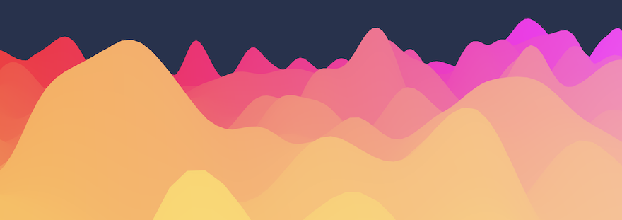

# Delta-V

A minty breath freshner for the large data visualization.

This framework simplifies some VERY difficult issues to address in handling graphics for
`large dynamic visualizations`.

## Installing

```sh
npm install -DE deltav
```

OR

```sh
yarn add deltav
```

OR

```sh
bun install
```

## Guide

Documentation is being rewritten.

## Run Demos and modify the source code

Lots of demos available! Used to test and visualize the framework as development
is executed on it! The project is developed with bun:

```sh
bun install
bun run dev
```

Then visit http://localhost:6006

Run the tests with `bun run test` and bundle the library into `dist` with
`bun run build`.

## Contributing

Make a PR. Make a very verbose description of what your changes accomplish.

You should probably file an issue as well for discussion and additional tracking.

Do NOT commit lock files.
