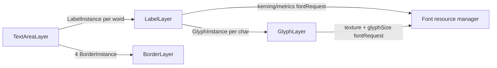

## Purpose

Text in deltav is a stack of three composite layers. `GlyphLayer` is the only one that draws: one
textured quad per character, sampled from a font map (atlas of rasterised/SDF glyphs) supplied by
the font resource. `LabelLayer` turns single-line `LabelInstance`s into positioned
`GlyphInstance`s using kerning metrics from the font resource. `TextAreaLayer` turns multi-line
`TextAreaInstance`s into one `LabelInstance` per word (plus border rectangles) and does wrapping,
alignment and clipping. Each level only manipulates the providers of the level below it.

## Key files

- `ui/src/2d/layers/labels/label-layer.ts` — `LabelLayer`, `ILabelLayerProps`: label → glyph manager.
- `ui/src/2d/layers/labels/label-instance.ts` — `LabelInstance`, `ILabelInstanceOptions`.
- `ui/src/2d/layers/labels/glyph-layer.ts` — `GlyphLayer`, `IGlyphLayerOptions`: renders glyph quads.
- `ui/src/2d/layers/labels/glyph-instance.ts` — `GlyphInstance`, `GlyphInstanceOptions`.
- `ui/src/2d/layers/labels/text-area-layer.ts` — `TextAreaLayer`, `ITextAreaLayerProps`: text area → labels + borders.
- `ui/src/2d/layers/labels/text-area-instance.ts` — `TextAreaInstance`, `TextAlignment`, `WordWrap`, `NewLineCharacterMode`, `TextAreaLabel`.
- `ui/src/2d/layers/labels/border-layer.ts` — `BorderLayer` (not exported by the barrel): rectangle shader positioned relative to a text area.
- `ui/src/2d/layers/labels/border-instance.ts` — `BorderInstance extends RectangleInstance` (`fontScale`, `textAreaOrigin`, `textAreaAnchor`).
- `ui/src/2d/layers/labels/glyph-layer-{always,bound-max,never}.{vs,fs}` — glyph shaders per `ScaleMode`.
- `ui/src/2d/layers/labels/text-area-layer-{always,bound-max,never}.{vs,fs}` — the same for glyphs inside a text area.
- `ui/src/2d/layers/labels/border-layer.vs`, `border-layer.fs` — border shaders.

## How it works

All three managers are `Layer2D`s whose `initShader()` returns `null`; they override `draw()` to
consume their provider's diffs (`resolveChanges()`, `InstanceDiffType.INSERT/CHANGE/REMOVE`),
use `getInstanceObservableIds` to test which properties changed, and expose children through
`childLayers()` + `createChildLayer`. They override `managesInstance()` (they have no buffer
manager) so the font resource manager can tell a live instance from a deleted one.

### LabelLayer: label → glyphs

1. INSERT (or a CHANGE on a label it has not seen): `insert` → `layoutGlyphs`.
2. `layoutGlyphs` first calls `updateKerning`. With no request yet, it issues
   `fontRequest({ key: resourceKey, character: "", kerningPairs: [text], metrics: { fontSize,
   text, letterSpacing, maxWidth?, truncation? } })` through `this.resource.request` and stops.
   The font resource manager deactivates the label (`active = false`), builds the font map and
   metrics, then sets `active = true`, which arrives as a CHANGE on `active`.
3. With `request.fontMap` and `request.metrics.layout` (a `KernedLayout`: `glyphs` = text minus
   whitespace, `positions`, `size`, `fontScale`) available, `updateGlyphs` reuses, creates or
   removes `GlyphInstance`s so there is one per non-whitespace character, adding them to
   `glyphProvider`. Then each glyph gets `offset = positions[i]`, `fontScale`, `origin`,
   `anchor`, `padding` and `maxScale`; `label.size = layout.size`.
4. Anchor: `anchorCalculator` maps `AnchorType` to a point on `label.size` (`TopLeft` = 0,0 …
   `BottomRight` = w,h; `Custom` keeps x/y). Padding is not added to the anchor as in
   rectangles: `paddingCalculator` stores `anchor.paddingDirection` (a vector pointing away
   from the anchor, length `padding`), which glyphs add to their position.
5. Truncation: when `maxWidth > 0` the request includes `maxWidth` and `truncation`
   (`props.truncation`, default `"..."`); the font manager returns a layout of the truncated
   text, so fewer glyphs are created.
6. Ready: every new glyph or glyph whose character is not yet in the font map is put in
   `labelWaitingOnGlyph`; `handleGlyphReady` (installed as the glyph's `onReady`) removes it and
   calls `label.onReady(label)` when the set empties.

CHANGE handling: `text`, `fontSize`, `maxWidth`, `letterSpacing` → new kerning request and full
layout; `active` → show/hide glyphs; `anchor` → `updateAnchor`; `color`, `origin`, `maxScale` →
copied to every glyph. REMOVE removes all glyphs. Pointer handlers (`onMouseClick`, `onTap`, …)
are wrapped by `mapHandler` so picking on glyphs reports the parent `LabelInstance`s.

`preload: true` labels are removed from the provider at insert and only request kerning; their
`resourceTrigger` is replaced to fire `onReady` (warms the font map for later labels).

### GlyphLayer: drawing

Per glyph quad (6 vertices, `normals` = corner 0..1): instance attributes `color`, `depth`,
`fontScale`, `anchor`, `origin`, `offset`, `padding`, `maxScale`, and two resource attributes on
the font resource named `fontMap` — `texture` (`FontResourceRequestFetch.TEXCOORDS`) and its
child `glyphSize` (`FontResourceRequestFetch.IMAGE_SIZE`), both driven by one cached
`fontRequest({ key, character })` per character (`glyphRequests`). The vertex position is
`origin + padding - anchor + offset + normals * glyphSize * fontScale` (ALWAYS), with the
anchor-relative part divided by `cameraScale2D` (NEVER) or by
`max(fontScale * cameraScale2D) / maxScale` once that exceeds `maxScale` (BOUND_MAX). The
fragment shader uses the red channel as alpha (`glyph-layer-always.fs`). Material:
`transparentImageBlending` with `depthTest: false`.

Shader choice: `props.scaleMode` (`GlyphLayer` falls back to `ALWAYS`; `LabelLayer` passes
`scaleMode || ScaleMode.BOUND_MAX`) and `props.inTextArea` (the text-area variants differ in
how they combine `origin`, `anchor` and `padding`). Changing `resourceKey` clears cached
`fontMap`s and calls `rebuildLayer()`.

### TextAreaLayer: text area → labels

1. `updateKerning` requests metrics for the whole text (same `fontRequest` shape as labels).
2. `updateLabels` splits the text with `generateWords` (on newlines, then spaces) and creates an
   inactive `LabelInstance` per word (`NewLineCharacterMode.NEWLINE` marks line breaks), all in
   `providers.labels`, tracked in `areaToLabels` and `areaWaitingOnLabel`. When every word
   label is ready, `handleLabelReady` sets `textArea.active = true` and calls its `onReady`.
3. `layout` (on `active`) → `updateLabels`, `layoutBorder`, `layoutLabels`.
4. `layoutLabels` walks the words with a cursor (`currentX`, `currentY`), inner box
   `maxWidth/maxHeight` minus `padding` (`[top, right, bottom, left]`), steps of
   `lineHeight`, and a space width from `fontMap.spaceWidth * fontScale` (else
   `props.whiteSpaceKerning` or `fontSize / 2`). Each placed label gets the text area's
   `origin`, a `Custom` anchor equal to the area's anchor point, and its in-box position as
   `anchor.paddingDirection`. `WordWrap.NONE` hides words that overflow the line,
   `WORD` moves the word to the next line, `CHARACTER` splits it with `seperateLabel` into new
   labels stored in `instance.newLabels`. Words that fall beyond `maxHeight` are deactivated.
   `setTextAlignment` shifts each finished line for `RIGHT`/`CENTERED`.
5. `layoutBorder` (when `hasBorder`) adds four `BorderInstance`s of width `borderWidth` around
   `maxWidth × maxHeight` to `providers.borders`, rendered by the child `BorderLayer`.

Child layers: `LabelLayer` (`scaleMode: props.scaling`, `inTextArea: true`,
`animate: props.animateLabel`, `customGlyphLayer`) and `BorderLayer`
(`animate: props.animateBorder`). CHANGE on `text`, `alignment`, `letterSpacing`, `fontSize` →
clear and rebuild labels; `wordWrap`, `lineHeight` → relayout; `maxWidth`, `maxHeight`,
`padding` → rebuild borders and relayout; `color` → labels, split labels and borders;
`origin` → translate everything by `origin - oldOrigin`.

## Extension points

- `customGlyphLayer` on `LabelLayer` / `TextAreaLayer`: any
  `ILayerConstructionClass<GlyphInstance, IGlyphLayerOptions<GlyphInstance>>`, typically a
  `GlyphLayer` subclass overriding `initShader()` (e.g. a different fragment shader for SDF
  rendering) — it receives the same props (`resourceKey`, `scaleMode`, `animate`, handlers).
- Per-character effects: after `onReady`, `label.glyphs` holds the `GlyphInstance`s; change
  their `color`, `offset`, `anchor` directly (animatable via `animate`).
- Truncation marker: `ILabelLayerProps.truncation`.
- Fonts: the layers only name a resource (`resourceKey`); create it with `createFont` — see
  [Text and fonts](../resources/text-and-fonts.md).

## Gotchas

- Labels render nothing until the font resource answers: instances are deactivated and
  reactivated asynchronously; read `label.size` / `label.glyphs` in `onReady`, not right after
  `add`.
- `TextAreaInstance` needs `maxWidth > 0`, `maxHeight > 0` and a `lineHeight`: with the
  defaults (0) every word fails the bounds test and is hidden, or all lines overlap.
  `hasBorder` defaults to `true` with `borderWidth` 6.
- `TextAreaLayer` REMOVE removes the word labels but not the border instances nor
  `newLabels` from split words; they stay on screen.
- `LabelInstance.depth` and `scale` are not forwarded to glyphs (glyph `depth` stays 0);
  `LabelInstance.truncatedText` is never filled (the truncated text lives in the request's
  `metrics.truncatedText`).
- `LabelInstance.subTextGlyphs` increments its glyph index before reading, so it returns the
  glyphs shifted by one.
- `LabelLayer.fullUpdate` / `TextAreaLayer.fullUpdate` are set on `resourceKey` change but never
  read; only `GlyphLayer` reacts to a new resource.
- Changing `LabelLayer`'s `scaleMode` calls `rebuildLayer()`; changing a label's `anchor` must
  assign a new object (or call `setAnchor`) to be observed.
- `GlyphLayer` disables depth testing, so overlapping text is ordered by draw order, not `depth`.
- In `GlyphLayer.initShader` the `NEVER` branch picks fragment shaders with `inTextArea`
  inverted; harmless today because both `-never.fs` files are identical.
- `glyph-layer-sdf.fs` is not used by any layer.

## Related

- [Text and fonts](../resources/text-and-fonts.md) — font maps, kerning, `fontRequest`, `createFont`.
- [2D layers](layers.md) — anchors, `ScaleMode`, `RectangleLayer` (base of borders).
- [2D view and camera](view-and-camera.md) — `cameraScale2D` used by the scale modes.
- [Resource management](../resources/resource-management.md) — how resource requests activate instances.
- [Layer](../surface/layer.md) — composite layers, `childLayers`, `draw`, `managesInstance`.
