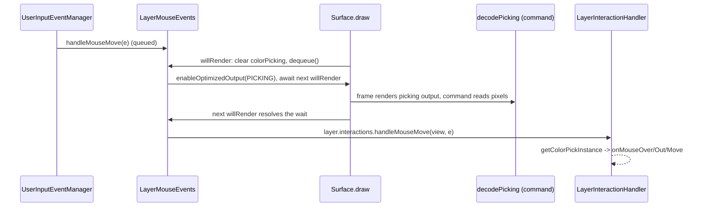

## Purpose

Picking turns a pointer position into the instances under it so layers can fire `onMouseOver`,
`onMouseClick`, `onTap` and the other instance callbacks. DeltaV implements it by color picking:
each instance renders its id as a color into a dedicated picking output, the pixels around the
pointer are read back, and the nearest non-black color is decoded to an instance.

## Key files

- `ui/src/shaders/base-modules/picking.shader.ts` — registers shader module `picking`: instance attribute `_pickingColor` (vec4 = `0xffffff - instance.uid`) and the `_picking_color_pass_` varying (`shader-fragments/picking.vs`).
- `ui/src/shaders/base-modules/shader-fragments/picking.fs` — fragment output writing `_picking_color_pass_` to the `PICKING` output.
- `ui/src/surface/event-managers/layer-mouse-events.ts` — `LayerMouseEvents`: the built-in `QueuedEventHandler` that requests picking renders and routes view events to layers.
- `ui/src/surface/layer-interaction-handler.ts` — `LayerInteractionHandler`: per-layer translation of view events into instance callbacks with over/down state.
- `ui/src/surface/surface-commands.ts` — `SurfaceCommands.decodePicking`: reads picking pixels and stores `IColorPickingData` on layers.
- `ui/src/types.ts` — `PickType`, `IPickInfo`, `IMousePickInfo`, `ITouchPickInfo`, `IColorPickingData`, `ISinglePickingMetrics`, `INonePickingMetrics`, `FragmentOutputType.PICKING`.

## How it works

### Pick modes

`PickType` has exactly two members: `NONE` (default) and `SINGLE` (color picking; returns at most
the one visually top-most instance). There is no query/all-instances mode in the source. The layer
prop `picking` is read in `Layer.init`; `Layer.picking` becomes an `ISinglePickingMetrics` or
`INonePickingMetrics`. Changing the prop triggers `rebuildLayer` (`Layer.willUpdateProps`). A layer
with no shader IO is forced to `NONE`.

### Shader side (PickType.SINGLE)

- `Layer` adds `"picking"` to the vertex imports, which brings in the `_pickingColor` instance
  attribute; `BasicIOExpansion` appends `_picking_color_pass_ = _pickingColor;` to the vertex main.
- If the layer's own fragment outputs do not declare `FragmentOutputType.PICKING`, the layer
  injects `picking.fs` as a `PICKING` output, per view, right after the last output that view
  actually renders. Declaring your own `PICKING` output *and* `picking: PickType.SINGLE` throws.
- Picking layers register instances in `Layer.uidToInstance` through the `handleDiffAddWithPicking*`
  / `handleDiffRemoveWithPicking*` diff handlers.

The picking output is only rendered by a view whose output buffers map
`FragmentOutputType.PICKING` to a texture or color buffer (see
[Color buffers](../resources/color-buffers.md)). If `ISurfaceOptions.optimizedOutputTargets`
contains `FragmentOutputType.PICKING`, that output is disabled every frame unless
`Surface.enableOptimizedOutput(PICKING)` was called for the frame.

### Decoding

`SurfaceCommands.decodePicking` (blocking GPU read) must be run by the app, normally from a
pipeline command, e.g. `CommandsJSX({ name: "decode-picking", callback: (s) => s.commands.decodePicking() })`.
For each view in `getCurrentInteraction().target.views`, it finds (and caches in
`pickingRenderTargets`) a render target over the view's `PICKING` buffer, then
`analyzePickedPixels` reads a 5×5 block around the pointer (scaled by `surface.pixelRatio` and
`view.projection.screenScale`), and `analyzeColorPickingRendering` picks the non-black color closest
to the block center. The resulting `IColorPickingData` (`nearestColor`, `allColors`, `colorData`,
`view`, `mouse`) is assigned to `layer.interactions.colorPicking` of every `SINGLE` layer in the
view's scene. `LayerInteractionHandler.getColorPickInstance(view)` decodes it as
`layer.uidToInstance.get(0xffffff - nearestColor)` when `colorPicking.view === view`.

### Event routing

`LayerMouseEvents` extends `QueuedEventHandler` (latest event per type). In `willRender` it deletes
every layer's `colorPicking`, resolves the previous `willRenderResolver`, makes a new one and
`dequeue()`s. Each handler then calls `enablePicking()` (down, move, click, tap, touch down/drag)
and awaits the next `willRender` (click and tap additionally re-enable and await `didRender`)
before calling `handleInteraction`, which maps `e.target.views` to scene views and calls the
callback for every layer in that view's scene whose `picking.type !== PickType.NONE`. It also
tracks which views are under the mouse (`isOver`) to emit view-level mouse out.

`LayerInteractionHandler` builds an `IMousePickInfo` / `ITouchPickInfo` (`instances`, `layer` id,
`screen`, `world` = `view.projection.screenToWorld(screen)`, `projection`, `interaction`, `touch`)
and calls the layer props:

| Handler | Layer callbacks |
|---|---|
| `handleMouseMove` | `onMouseOut` (instances no longer over), `onMouseOver` (newly over), `onMouseMove` (all, even empty) |
| `handleMouseDown` / `handleMouseUp` | `onMouseDown`; `onMouseUp`, then `onMouseUpOutside` for down instances not under the up point |
| `handleMouseClick` | `onMouseClick` |
| `handleMouseOut` | `onMouseOut` with every instance still over (pointer left the view) |
| `handleTouchDown` | `onTouchOver`, `onTouchDown` |
| `handleTouchMove` | `onTouchOut`, `onTouchOver`, `onTouchMove` |
| `handleTouchUp` | `onTouchOut`, `onTouchUp`, `onTouchUpOutside`, then `onTouchAllEnd` when no touch is down |
| `handleTap` | `onTap` |

`handleMouseOver`, `handleTouchOver` (view level) and `handleMouseDrag` are no-ops. Callbacks with
no picked instance still fire with `instances: []` (except over/out, which fire only when non-empty).

## Extension points

- Enable picking on a layer: `picking: PickType.SINGLE` plus at least one callback prop.
- Render picking: give a view an output buffer for `FragmentOutputType.PICKING` and run
  `surface.commands.decodePicking()` in the pipeline.
- Render picking only on demand: `optimizedOutputTargets: [FragmentOutputType.PICKING]` on the
  surface; `LayerMouseEvents` calls `enableOptimizedOutput` when an event needs it.
- Custom picking output: declare your own `FragmentOutputType.PICKING` fragment output and leave the
  `picking` prop unset; you then own decoding too (`IColorPickingData` is not filled for `NONE`
  layers).
- Non-instance interaction (raw positions): a custom `EventManager` (see
  [Event management](event-management.md)).

## Gotchas

- Instance callbacks are asynchronous: they fire one or more frames after the DOM event, and only
  if frames are being drawn. Only the latest event of each type per frame reaches layers.
- `decodePicking` is not called automatically; without it `colorPicking` stays empty and
  `instances` is always `[]`.
- Picking is skipped for a view with `optimizeRendering` true (`BasicCamera2DController` sets it on
  views being dragged), so hover does not update while panning.
- A Texture used as picking target with `generateMipMaps` enabled triggers a one-time warning;
  mipmaps/filtering blend id colors. Clear the picking view to black: color `0x000000` means
  "nothing".
- Instance uids wrap at `0xffffff` (`Instance.newUID`), so more than ~16.7M instance creations can
  collide.
- Only the top-most rendered instance is found; occluded instances are invisible to picking.
- `handleTouchMove` stores its result in `isMouseOver` (not `isTouchOver`) and `handleTouchOut`
  reports `isMouseOver` instances; `LayerMouseEvents.handleTouchOut` clears `isOver`. Touch
  over/out bookkeeping is therefore unreliable; `onTouchAllOut` is declared on layer props but never
  called.
- Wheel events are not routed to layers.

## Related

- [Event management](event-management.md) — where the interactions come from.
- [Color buffers](../resources/color-buffers.md) — the buffer the picking output renders into.
- [Surface commands](../surface/commands.md) — `SurfaceCommands` and pipeline commands.
- [Shader modules](../shaders/shader-modules.md) — how the `picking` module is registered and imported.
- [Layer](../surface/layer.md) — layer props, `uidToInstance`, `interactions`.
